<div align="center">


<br />

<a href="https://www.linkedin.com/in/ashay-deshpande-554683387"></a>
<a href="mailto:ashay.deshpande08@gmail.com"></a>
<a href="https://github.com/ashaydeshpande31"></a>
<br />
<a href="https://sipnaaws-club.vercel.app"></a>


</div>


## 🧑‍💻 About Me



```yaml
name: Ashay A.S. Deshpande

education:
  degree: B.Tech Information Technology
  college: Sipna College of Engineering & Technology, Amravati
  year: Second Year (2025 - 2029)

role: Aspiring Full Stack Developer

location: Amravati, Maharashtra, India

communities:
  - AWS Student Builder Group at Sipna
  - Sipna Coders Club (website team)
  - Unstop Campus Champion

currently_learning:
  - DSA
  - CS Fundamentals (DBMS, OS, Networks)
  - AWS Cloud
  - Git branching and pull requests

currently_building:
  - Sipna AWS Club Website
  - Certify (certificate automation)
  - Kaushal Setu (Smart India Hackathon 2026)

next_up:
  - Smart Study Monitor
  - Open source with GSSoC

goal: Software Developer / Full Stack Developer
```


## 🧰 Tech stack


<div align="center">
  
</div>

<br />

| Layer | What I use |
| :-- | :-- |
| 🎨 **Frontend** | React · Vite · Tailwind CSS · HTML5 · CSS3 · JavaScript |
| 🎬 **Motion & 3D** | GSAP + ScrollTrigger · Lenis smooth scroll · Three.js · SVG animation · Web Audio API |
| ⚙️ **Backend** | Python · Django · Google OAuth |
| ☁️ **Cloud & deploy** | AWS (learning) · Vercel · Render · GitHub Actions |
| 🧪 **Tools** | Git · GitHub · VS Code |


## 🚀 Featured projects

<table>
<tr>
<td width="50%" valign="top">

### ☁️ Sipna AWS Club Website

A cinematic site for the AWS Student Builder Group at Sipna: a **power-on boot intro with synthesized sound**, animated circuit boards, a Hall of Fame, event galleries, and a team and events system that anyone can update by dropping photos into a folder.

    

**[Live site →](https://sipnaaws-club.vercel.app)**

</td>
<td width="50%" valign="top">

### 🎓 Certify

Certificate automation for event organisers. Upload a participant list (Excel or PDF) or add people one by one, and Certify generates the certificates and emails them from your own Gmail through Google Sign-In.

   

**[Source code →](https://github.com/ashaydeshpande31/certify-app)**

</td>
</tr>
<tr>
<td width="50%" valign="top">

### 🏆 Kaushal Setu · Smart India Hackathon 2026

My team's (**Team delta-X**) Smart Education entry: connecting skill-development programs with what the industry and the job market actually need.


</td>
<td width="50%" valign="top">

### 🖼️ Personal Portfolio

A bold, minimal portfolio in plain HTML and CSS, with outlined typography and a clean list of social links.

 

**[Source code →](https://github.com/ashaydeshpande31/portfolio)**

</td>
</tr>
</table>


## 🐍 Contribution snake

<div align="center">
  <picture>
    <source media="(prefers-color-scheme: dark)" srcset="https://raw.githubusercontent.com/ashaydeshpande31/ashaydeshpande31/output/github-snake-dark.svg" />
    <source media="(prefers-color-scheme: light)" srcset="https://raw.githubusercontent.com/ashaydeshpande31/ashaydeshpande31/output/github-snake.svg" />
    
  </picture>
</div>


## 📬 Let's connect

I like building things that move, and I'm happy to collaborate, swap ideas, or talk cloud and frontend.

<a href="https://www.linkedin.com/in/ashay-deshpande-554683387"></a>

<br />


